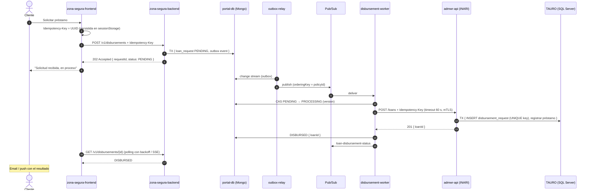
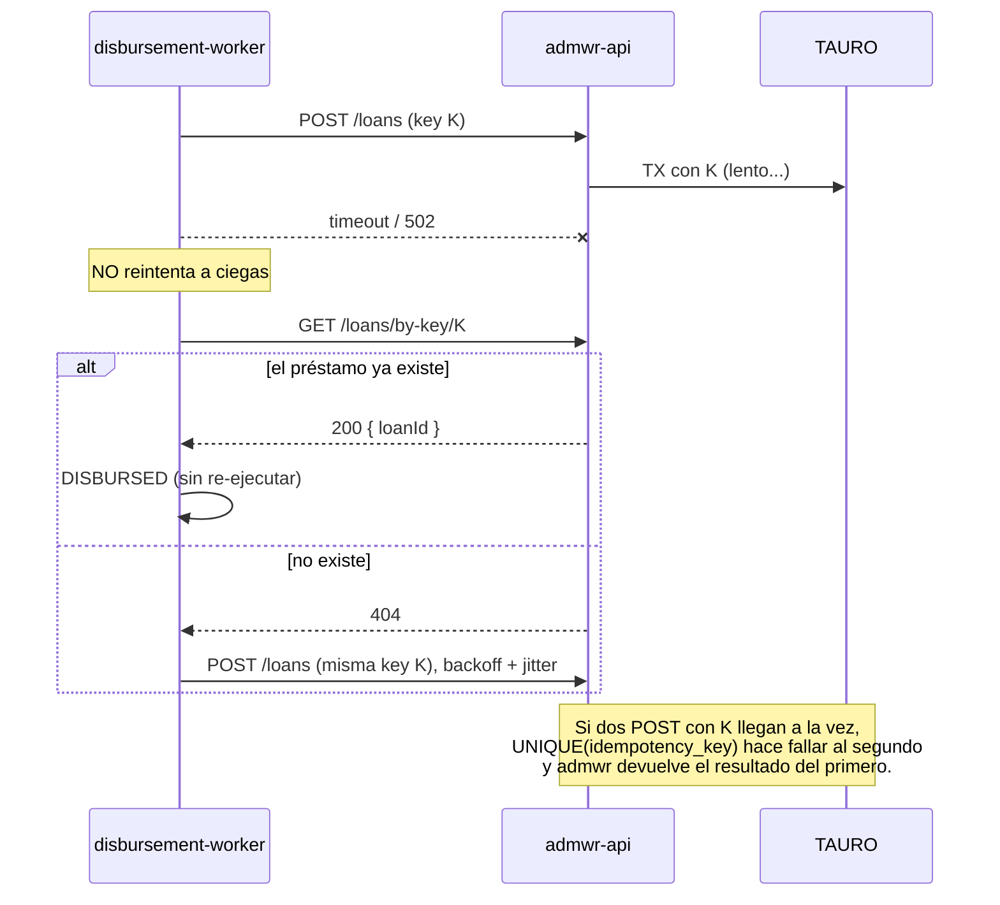

# Reto 3: Préstamos de Renta Particular, arquitectura TO BE

Diagrama editable: [architecture/prestamos-renta-particular.drawio](../architecture/prestamos-renta-particular.drawio) (dos páginas: **AS IS** y **TO BE**). Se abre en draw.io desktop o en app.diagrams.net → *File › Open*.
Vistas previas: [as-is.svg](../architecture/as-is.svg) · [to-be.svg](../architecture/to-be.svg).

## 1. Diagnóstico (AS IS)

| Síntoma | Causa raíz |
|---|---|
| El cliente ve **502** aunque el préstamo se procesa | El flujo es **síncrono**: la experiencia del cliente depende de la latencia de INARI y del timeout del proxy. |
| **Desembolsos duplicados** | No existe una **clave de idempotencia** de extremo a extremo: cada reintento es una operación nueva para admwr. |
| Doble clic o doble pestaña | No hay **control de concurrencia** por póliza. |
| Nadie detecta el caso "procesado tras el 502" | No hay **conciliación** de estados inciertos. |

El objetivo no es "subir el timeout" (eso solo mueve el problema). Hay que **desacoplar** al cliente de INARI y hacer que **la misma intención nunca pueda ejecutarse dos veces**, aunque haya reintentos, caídas o mensajes duplicados.

## 2. Solución (TO BE)

### Flujo feliz

### Falla de latencia (el caso que hoy duplica)

## 3. Criterios evaluados

### Resiliencia y reintentos
- **Desacople**: el cliente recibe `202` en menos de 300 ms. La latencia de INARI ya no la ve el usuario: solo retrasa el resultado.
- **Outbox transaccional**: la solicitud y su evento se guardan en la misma transacción de Mongo, así ninguna solicitud aceptada queda sin publicarse. El relay publica *at-least-once*.
- **Reintentos seguros**: backoff exponencial con jitter y `maxDeliveryAttempts = 5`. Ante un timeout, el worker **consulta antes de reintentar** (`GET /loans/by-key`).
- **Circuit breaker** en el worker: si INARI está degradado, deja de golpearlo y los mensajes esperan en Pub/Sub sin perderse.
- **DLQ** con alerta a Operaciones, y un **job de conciliación** que cierra los `PROCESSING` atascados y hace un cuadre diario de solicitudes contra desembolsos.

### Control de concurrencia (anti-duplicidad en 3 capas)
1. **Frontend**: una clave por intención de préstamo, persistida. Refrescar o reintentar reutiliza la clave.
2. **portal-db**:
   - `UNIQUE(idempotencyKey)`: la misma clave devuelve la misma solicitud.
   - `UNIQUE parcial(policyId)` con estado activo: dos pestañas con claves distintas no pueden tener dos solicitudes vivas para la misma póliza (responde `409` con la vigente).
3. **admwr / TAURO**: `UNIQUE(idempotency_key)` **en la misma transacción** que el registro del préstamo. Es la garantía final: aunque Pub/Sub entregue dos veces, el worker reintente o un operador reprocese desde la DLQ, SQL Server rechaza el segundo insert.

Además:
- **CAS** sobre `version` al pasar `PENDING → PROCESSING`: un solo worker toma cada solicitud.
- **orderingKey = policyId**: los mensajes de una misma póliza se procesan en orden.
- `concurrency=1` y `max-instances=3` en el worker: como máximo 3 llamadas simultáneas a INARI. Eso protege a admwr, que es la causa de la latencia original.

### Escalabilidad
- Cloud Run (frontend, backend, worker, notifier) escala por demanda y baja a cero.
- Pub/Sub absorbe picos (por ejemplo, el inicio de mes): el backend sigue aceptando a la velocidad de Cloud Run y el worker drena al ritmo que INARI soporta (*load leveling*).
- Para escalar el consumo basta con subir `max-instances` del worker, en coordinación con la capacidad de INARI. No hace falta tocar código.

### Seguridad
- **Cloud Armor**: WAF con reglas OWASP y rate limit por usuario/IP en `/disbursements`, para frenar bots y abusos de reintento.
- **Identidad**: el JWT/OIDC del cliente se valida en el backend. La `Idempotency-Key` se asocia al `userId`, así que la clave de otro usuario no sirve (anti-replay).
- **Red**: solo el worker y el job de conciliación llegan a INARI, vía **Serverless VPC Access + Cloud VPN/Interconnect**, con **mTLS** y allowlist de IP. El backend público ya no tiene ruta a la red interna, lo que reduce la superficie expuesta.
- **Secretos** en Secret Manager y cuentas de servicio con mínimo privilegio (el worker solo publica y consume sus tópicos).
- **Auditoría**: Cloud Audit Logs más trazas con `correlationId = idempotencyKey` de punta a punta, incluido admwr.

### Costo de implementación
| Componente | Costo incremental estimado* | Comentario |
|---|---|---|
| Cloud Run (worker, relay, notifier, job) | ~USD 0 | Escala a cero; el volumen de préstamos cabe en el free tier. |
| Pub/Sub (3 tópicos + DLQ) | ~USD 0 | Los primeros 10 GiB al mes son gratis. |
| Cloud Scheduler | USD 0 | 3 jobs gratis por cuenta de facturación. |
| Cloud Armor (Standard) | ~USD 5–10/mes | Una política con pocas reglas, más un cargo por millón de requests. |
| Mongo replica set | USD 0 | Un replica set de un solo nodo habilita transacciones y change streams en la VM existente. |
| VPN/Interconnect | USD 0 | Se reutiliza la conectividad actual GCP ↔ IS-VCE. |
| **Esfuerzo** | ~4–6 semanas de un squad | Endpoints async en el backend, worker, idempotencia en admwr (tabla + índice + endpoint de consulta), pantalla de estado, conciliación y pruebas de caos. |

\* Precios de lista aproximados de GCP; se validan con la calculadora antes de comprometerlos.

**Plan incremental (bajo riesgo):**
1. Idempotencia en admwr: tabla, índice único y header. Por sí sola ya elimina la duplicidad en el flujo actual.
2. Clave en frontend y backend, más el índice único en portal-db.
3. Flujo asíncrono (202, outbox, Pub/Sub, worker) y pantalla de estado.
4. Conciliación, DLQ y alertas.

## 4. Alternativas consideradas

| Opción | Por qué no (o cuándo sí) |
|---|---|
| Subir el timeout del proxy | No elimina la duplicidad: un timeout mayor solo hace el caso menos frecuente, y empeora la experiencia. |
| Lock distribuido en Redis (Memorystore) | Agrega costo (~USD 35+/mes) y un nuevo punto de falla. Un índice único en BD da la misma garantía con más fuerza (es durable). |
| **Cloud Tasks** en lugar de Pub/Sub | Opción válida: deduplica por nombre de tarea y limita la tasa hacia INARI de forma nativa. Se eligió Pub/Sub por su ecosistema (DLQ, ordering, fan-out para notificaciones y analítica) y porque la arquitectura de referencia ya contempla una capa *Publisher*. |
| Saga / compensaciones | Útil si el desembolso abarcara varios sistemas con rollback. Aquí la operación crítica es una sola (admwr), así que idempotencia más conciliación es más simple y suficiente. |
