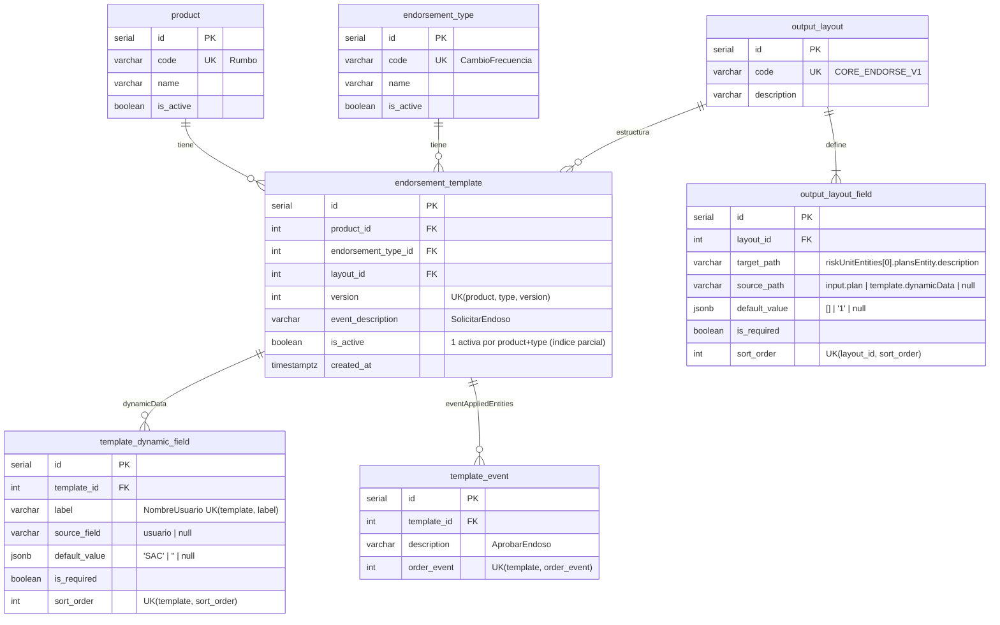

# Modelo de datos: plantillas dinámicas de endosos



## Decisiones

| Necesidad del reto | Cómo la resuelve el modelo |
|---|---|
| Plantilla según **producto + tipo de endoso** | `endorsement_template` con FK a `product` y `endorsement_type`. |
| **Orden y etiquetas** de `dynamicData` | `template_dynamic_field.label` + `sort_order` (único por plantilla). |
| **Lista y orden** de `eventAppliedEntities` | `template_event.order_event` (único por plantilla). |
| **Valores por defecto** si el campo no viene | `default_value JSONB` en los campos de layout y de dynamicData. JSONB admite `""`, `"1"`, `[]` u objetos sin cambiar el esquema. |
| **Estructura y orden** del JSON del core | `output_layout_field`: cada fila escribe un valor en `target_path`; el `sort_order` fija el orden de las claves. Si el core publica un contrato nuevo se crea otro `output_layout` (V2) y las plantillas migran por datos. |
| **Campos obligatorios** | `is_required`. Si falta el valor y no hay default, la API responde 422 con la lista completa de faltantes. |
| **Versionado de plantillas** | `version` + `is_active`. Un índice único parcial (`WHERE is_active`) garantiza una sola versión activa. Las versiones anteriores quedan como historial y se pueden reactivar (rollback por datos). |
| **Integridad** | `CHECK (source IS NOT NULL OR default_value IS NOT NULL)`: ningún campo queda sin forma de resolverse. Además las rutas se validan al leer la plantilla (y se bloquea `__proto__`). |

## Regla de resolución (una sola, para todos los campos)

1. El valor del origen (`input.X` del JSON plano, o `template.*` calculado), si viene y no está vacío.
2. Si no, `default_value`.
3. Si no, y el campo es `is_required`, se reporta como faltante (422).
4. Si no, `null`.

## Agregar un producto o tipo de endoso nuevo (sin desplegar código)

```sql
INSERT INTO product (code, name) VALUES ('VidaFlex', 'Vida Flex');
INSERT INTO endorsement_type (code, name) VALUES ('CambioBeneficiario', 'Cambio de beneficiario');

WITH t AS (
  INSERT INTO endorsement_template (product_id, endorsement_type_id, layout_id, version, event_description)
  SELECT p.id, et.id, l.id, 1, 'SolicitarEndoso'
    FROM product p, endorsement_type et, output_layout l
   WHERE p.code = 'VidaFlex' AND et.code = 'CambioBeneficiario' AND l.code = 'CORE_ENDORSE_V1'
  RETURNING id
)
INSERT INTO template_dynamic_field (template_id, label, source_field, default_value, is_required, sort_order)
SELECT t.id, v.label, v.source_field, v.default_value::jsonb, v.is_required, v.ord FROM t,
(VALUES ('ProductosVida',      'producto',     NULL,              true,  1),
        ('NumeroPolizaEndoso', 'policyNumber', NULL,              true,  2),
        ('Beneficiario',       'beneficiario', NULL,              true,  3),
        ('ResponsableAtencion', NULL,          '"SAC"',           false, 4)) AS v(label, source_field, default_value, is_required, ord);

INSERT INTO template_event (template_id, description, order_event)
SELECT et.id, e.d, e.o FROM endorsement_template et
  JOIN product p ON p.id = et.product_id AND p.code = 'VidaFlex',
  (VALUES ('SolicitarEndoso', 1), ('AprobarEndoso', 2)) AS e(d, o);
```

La siguiente petición con `"producto": "VidaFlex", "tipoEndoso": "CambioBeneficiario"` ya se traduce con esta plantilla, y `GET /v1/templates` la muestra en el formulario del frontend.
